<div align="center">
  <picture>
    <source media="(prefers-color-scheme: dark)" srcset="kort/apps/web/public/kort-readme-logo-inverted.svg" />
    
  </picture>
</div>

<h1 align="center">Knights of the Round Table</h1>

<p align="center">
  KORT is a self-hosted chat application that puts one question in front of a panel of models,<br/>
  replays their deliberation, and keeps a single final answer.<br/>
  Model access is bring-your-own-key over OpenAI, OpenAI Responses or Anthropic endpoints.
</p>

<p align="center">
  <a href="README.zh-CN.md">简体中文</a>
  ·
  <a href="#interface">Interface</a>
  ·
  <a href="#architecture">Architecture</a>
  ·
  <a href="#quick-start">Quick start</a>
  ·
  <a href="#api-surface">API</a>
  ·
  <a href="kort/docs/architecture-rules.md">Architecture rules</a>
</p>

<p align="center">
  
  
  
  
  
  
  
</p>

<p align="center">
  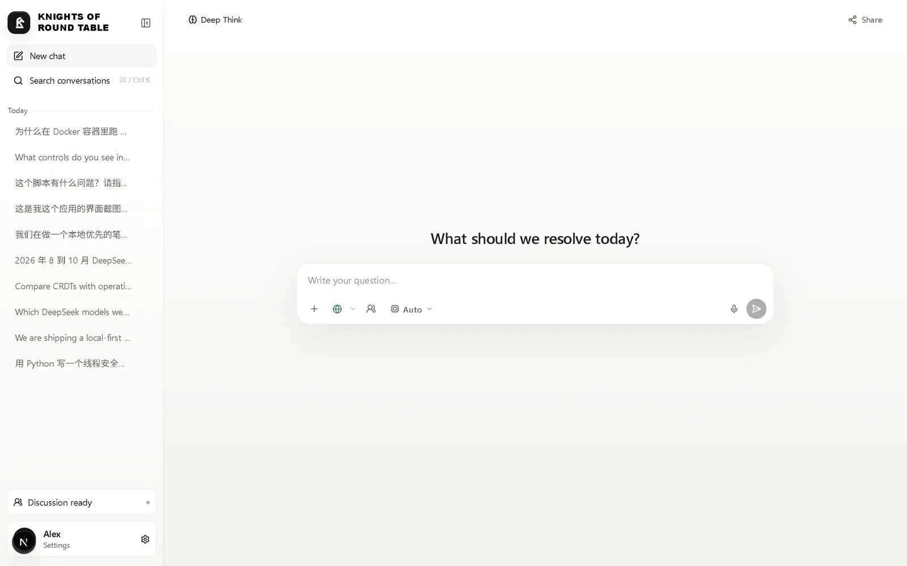
</p>

---

## What KORT is

A question enters one of three routes:

| Route | Condition | Behaviour |
| --- | --- | --- |
| Expert panel | Discussion level `auto` / `low` / `medium` / `high` | LangGraph runs expert and critic rounds, a summarizer projects stage summaries, a synthesizer writes the final answer |
| Solo thinking | Panel off + Deep Think on | One agent reasons, with the same tool loop and the same event contract |
| Direct answer | Panel off | A harness seat with no persona answers in one pass |

All three share one event stream, one message-tree schema and one persistence path, so the UI, the
full-text index and the memory layer never branch on which route answered.

Product boundary: raw expert transcripts and provider reasoning content stay in backend runtime
state. Streamed, stored and indexed content is limited to stage summaries, the public deliberation
lines rendered in the discussion room, and the final answer.

## Interface

### Discussion room

With the panel on, each answer carries a seat strip. Opening it replays the deliberation: one pixel
character per delegated seat around a fire, one speech bubble at a time, playback speed 0.75×–2×, a
transcript sheet for reading instead of watching, night and daylight room themes, and a stop at the
final remark rather than a loop.

<table>
  <tr>
    <td width="50%">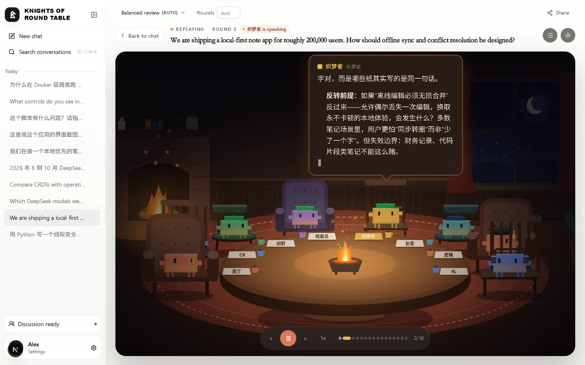</td>
    <td width="50%">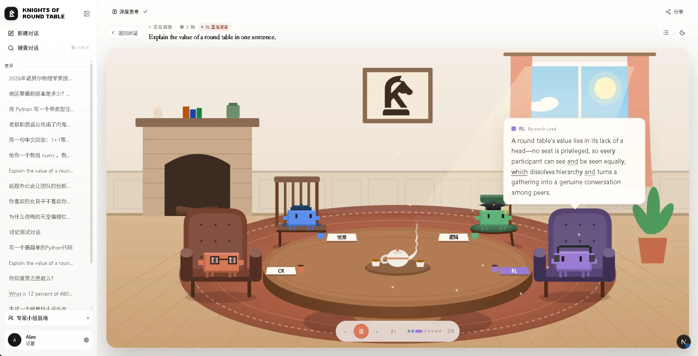</td>
  </tr>
  <tr>
    <td colspan="2">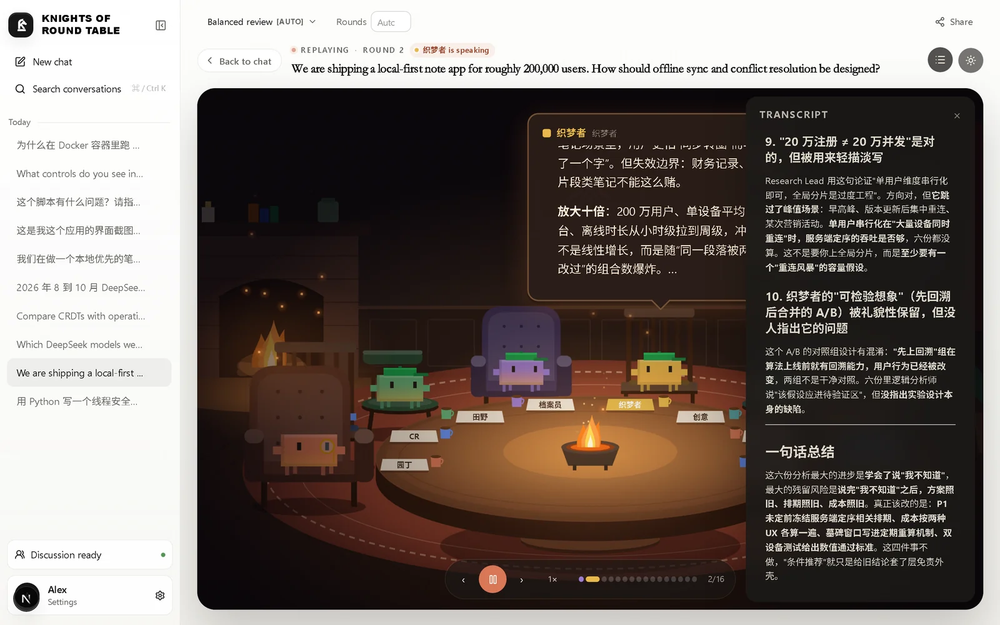</td>
  </tr>
</table>

The seat figures are reproductions of Anthropic's Clawd mascot; provenance and credit are recorded in
[Trademarks and credits](#trademarks-and-credits).

Bundled experts carry Chinese personas, so panel output stays in Chinese regardless of the question
language; the single-model routes follow the question language. Names, prompts, roles and priorities
are editable in Settings.

### Thinking strip and drawer

Every answer sits under a collapsed thinking strip: current stage, delegated agents, elapsed time,
and each web search or page fetch. Expanding it opens the right-hand drawer with the full tree —
stage summaries, tool calls with arguments, and the deliberation structure.

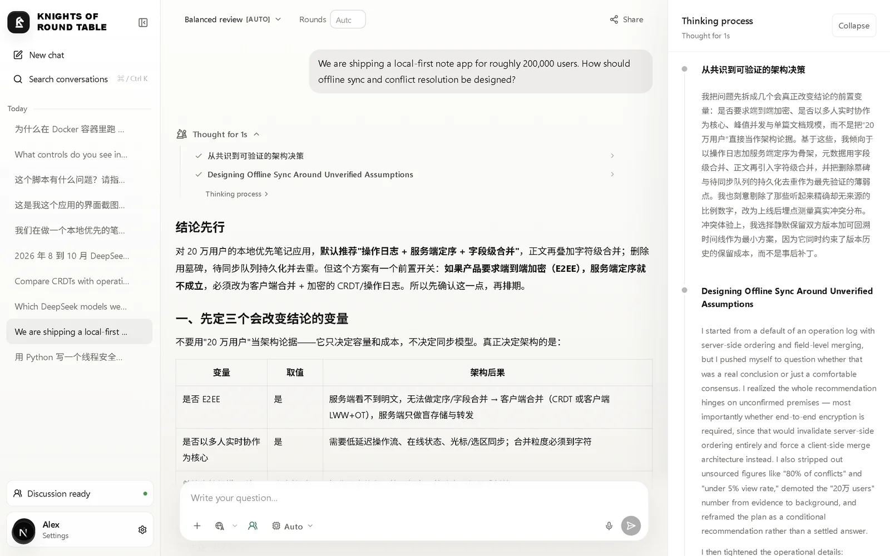

### Model and level pickers

The composer toggle switches between expert panel and single model. In single-model mode the picker
is provider-first: one row per configured provider with its brand icon, model list in a sideways
flyout, so many providers and many models stay compact. Vision-capable models are marked with an eye
icon.

<table>
  <tr>
    <td width="50%">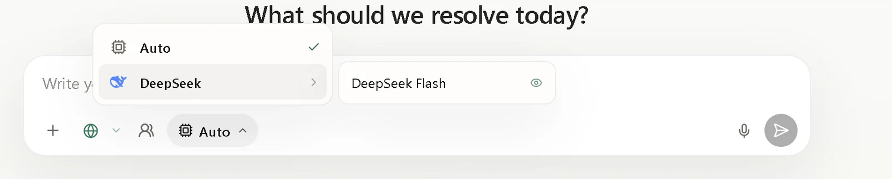</td>
    <td width="50%">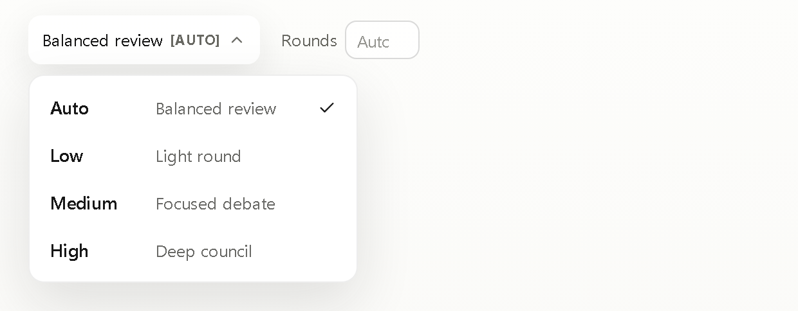</td>
  </tr>
</table>

Discussion depth is a level rather than a boolean. `auto` defers to the router, `low` keeps the
exchange short, `medium` and `high` open the floor, and the round ceiling is configurable between 1
and 12. With the panel off, the same slot becomes the Deep Think switch.

### Attachments

The `+` button opens a two-entry menu — image, text file — instead of a file dialog. Images are
decoded in the browser, rotated by EXIF, rescaled to a 1600px longest edge and re-encoded as JPEG at
quality 0.86; a 12MB phone photo usually leaves as one or two hundred KB. The chip reports the real
dimensions and the compressed size.

<table>
  <tr>
    <td width="50%">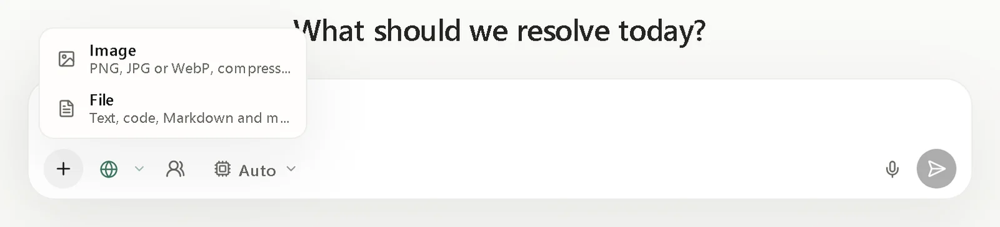</td>
    <td width="50%">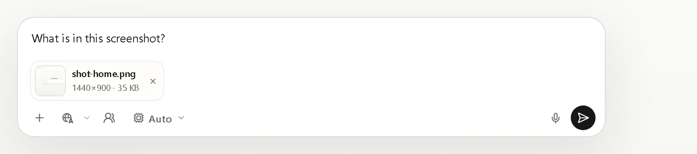</td>
  </tr>
  <tr>
    <td colspan="2">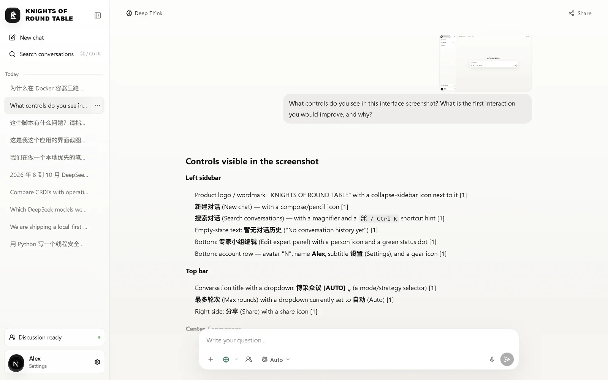</td>
  </tr>
</table>

Image input requires a vision-capable model and discussion level `off`. Both conditions are enforced
twice: the composer disables send with a stated reason, and the backend rejects the branch with 422
before writing anything. Text attachments (code, Markdown, logs) work on all routes and enter the
prompt with their character count. The microphone button dictates through the browser
`SpeechRecognition` API.

### Web search

Search is a tri-state control — `auto`, `required`, `disabled` — and applies inside the reasoning
loop rather than only to the first turn: the model can think, call `web_search`, `web_fetch` a page,
and continue. Calls render as rows in the thinking strip, and inline citations number the sources in
the answer.

<table>
  <tr>
    <td width="40%">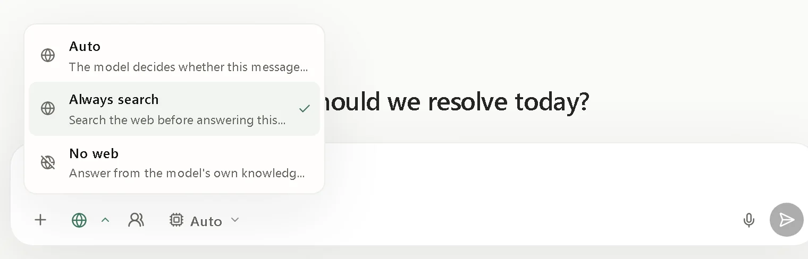</td>
    <td width="60%">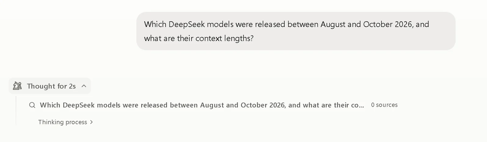</td>
  </tr>
  <tr>
    <td colspan="2">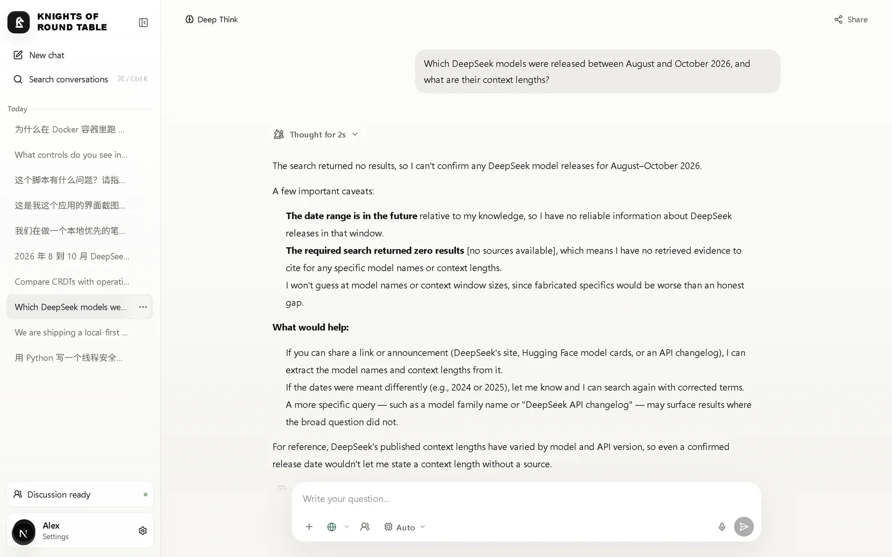</td>
  </tr>
</table>

### Markdown rendering

Answers render as Markdown with GFM tables, KaTeX math and highlighted code. Streaming is applied
per sentence instead of re-rendering the whole message per token, which keeps long answers from
shifting during output.

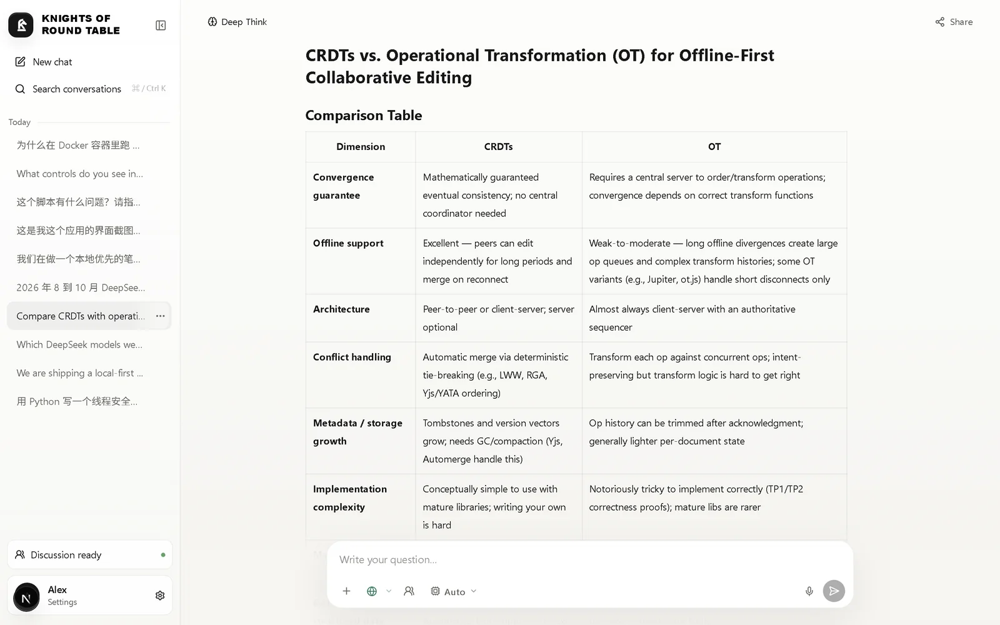

### Branches

Messages form a tree. Editing a question or triggering Regenerate creates a sibling branch instead
of overwriting history, with `< 2 / 2 >` navigation between siblings. Follow-up turns extend the
selected branch, so a conversation can fork.

<table>
  <tr>
    <td width="50%">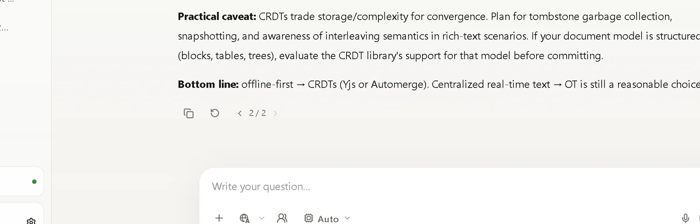</td>
    <td width="50%">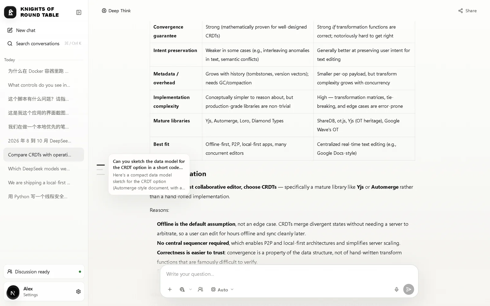</td>
  </tr>
</table>

### Search and history map

<kbd>Ctrl</kbd>/<kbd>⌘</kbd> + <kbd>K</kbd> opens conversation search over titles and message bodies,
backed by a SQLite FTS index, with byte-safe highlighting and direct jumps to the matched message.
Within a conversation, a left rail maps each turn to a tick with hover preview and click-to-jump.

<table>
  <tr>
    <td width="50%">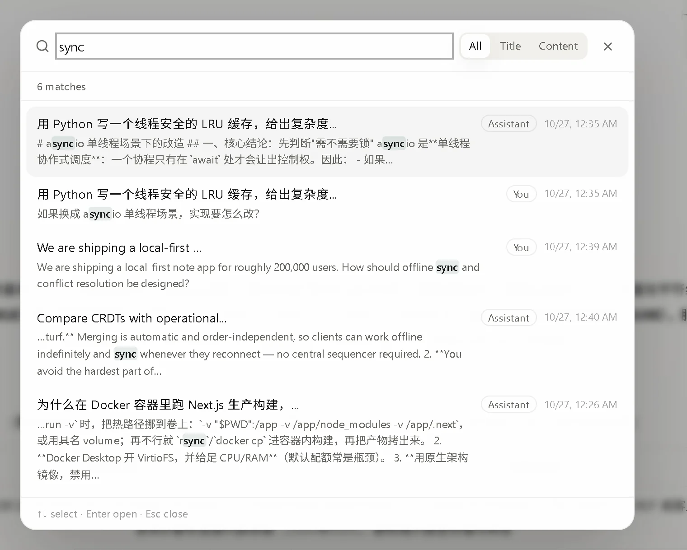</td>
    <td width="50%">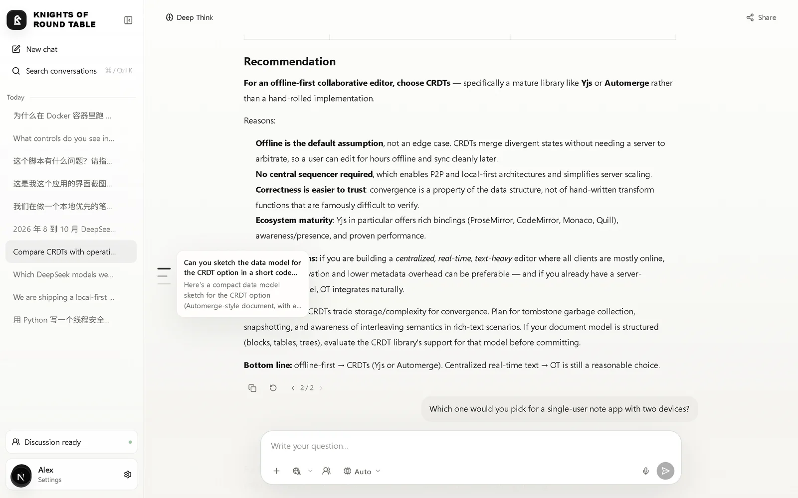</td>
  </tr>
</table>

### Settings

Seven tabs: general (language, developer mode, log level), models (providers, keys, endpoints),
expert panel (roles, prompts, priorities, skill access), memory, skills, data, developer.

<table>
  <tr>
    <td width="50%">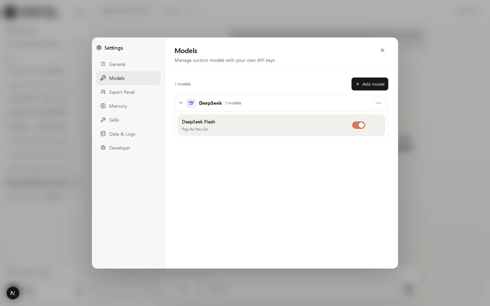</td>
    <td width="50%">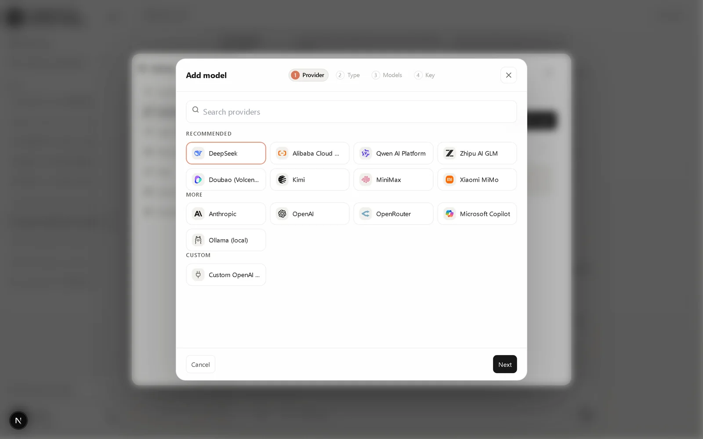</td>
  </tr>
  <tr>
    <td width="50%">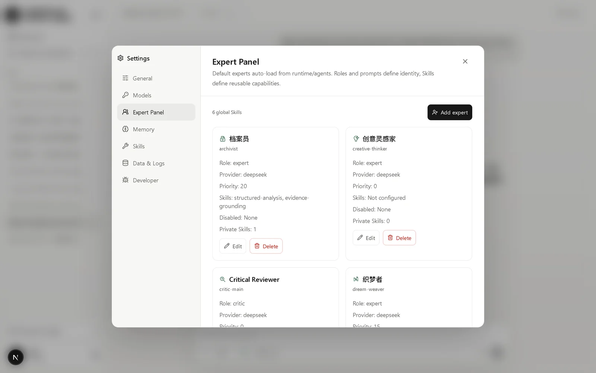</td>
    <td width="50%">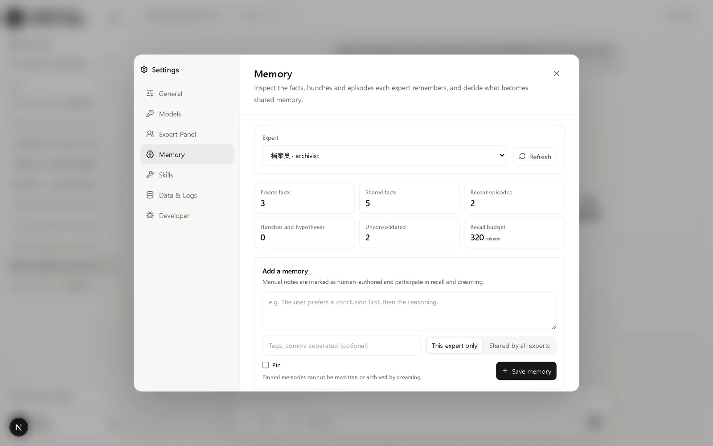</td>
  </tr>
  <tr>
    <td width="50%">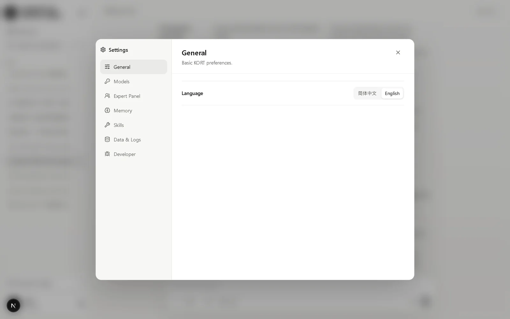</td>
    <td width="50%">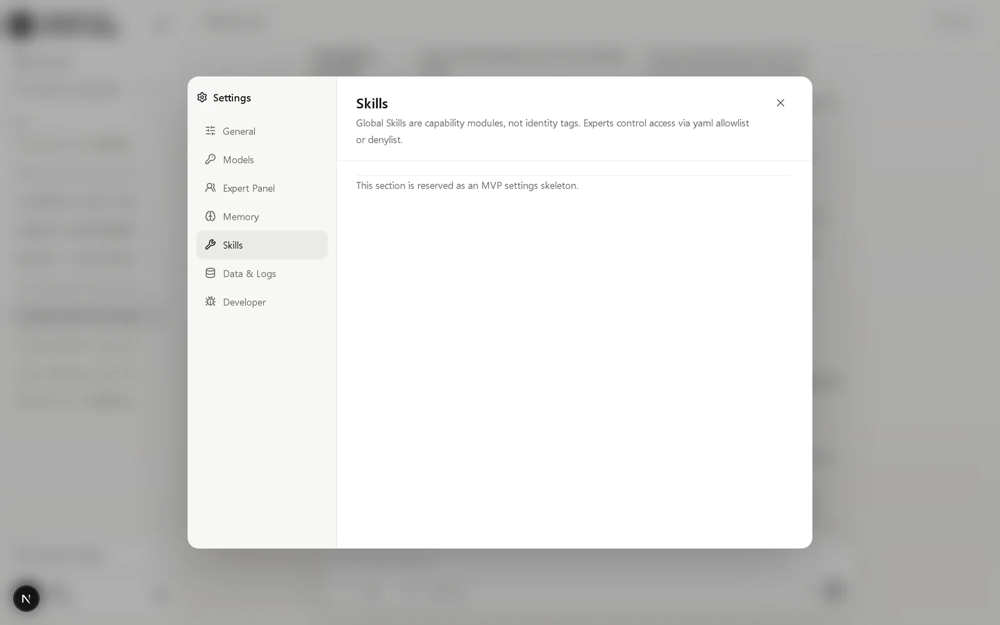</td>
  </tr>
</table>

Provider setup is a four-step dialog (provider → API type → models → key). The catalog holds fourteen
entries: DeepSeek, Alibaba Cloud Model Studio, Qwen AI Platform, Zhipu GLM, Doubao (Volcengine Ark),
Kimi, MiniMax, Xiaomi MiMo, Anthropic, OpenAI, OpenRouter, Microsoft Copilot, Ollama, and any
OpenAI-compatible custom endpoint. Keys are written to a local file; the API reports only a
configured boolean.

### Memory and dreams

Each agent keeps private facts, hunches and episodes alongside a shared pool. Retrieval is
token-budgeted. A dream is a consolidation pass: proposed facts, merges, archives and promotions to
shared memory, available as a dry run with a readable journal before any write, with a snapshot of
the agent folder taken first. Dream input is limited to user-visible material — question, stage
summaries, final answer.

### Narrow viewports

At mobile widths the layout collapses to one column, the sidebar becomes a drawer, and the model
picker becomes a full-screen list with a back header.

<table>
  <tr>
    <td width="50%">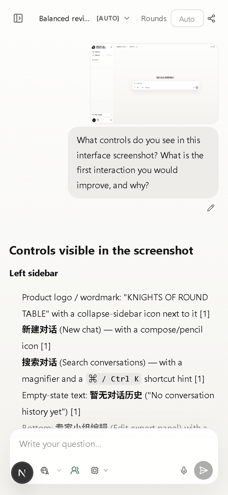</td>
    <td width="50%">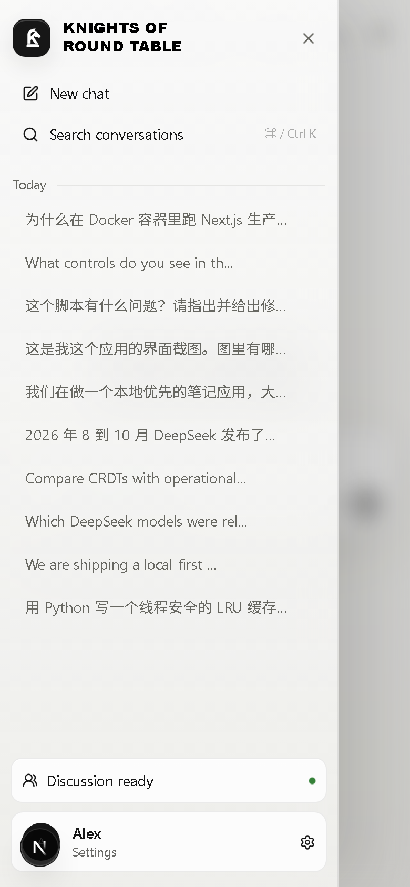</td>
  </tr>
</table>

## Architecture

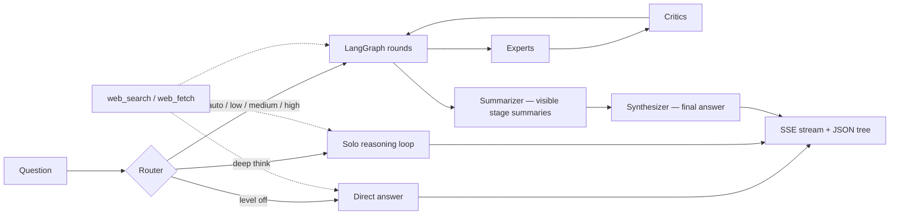

Core rules:

- Hidden chain-of-thought is never sent to the client, persisted, or logged.
- Discussion orchestration lives only in `kort_api/orchestration.py`; the direct and solo paths
  reuse the same events and the same node shape rather than running a second loop.
- Every payload crossing the boundary is Pydantic-validated; frontend types mirror the backend
  schema and validation failures fail closed.
- Provider secrets stay in the local secrets file or environment variables — never in YAML, SQLite,
  API responses or logs.
- Product code lives under `kort/apps`; agents, skills, provider profiles and data live under
  `kort/runtime`.

See [architecture-rules.md](kort/docs/architecture-rules.md).

## Quick start

### Docker

```bash
docker compose up --build
```

| Service | URL |
| --- | --- |
| Web app | <http://localhost:3000> |
| API | <http://localhost:8000> |
| Interactive API docs | <http://localhost:8000/docs> |
| Health check | <http://localhost:8000/health> |

### Windows launcher

`start-dev.cmd` at the repository root checks Node and pnpm, creates `.venv` when missing, installs
dependencies, starts both servers and opens the browser. Set `KORT_OPEN_BROWSER=0` to skip the
browser step.

### Manual

```bash
# backend
py -3.13 -m venv .venv
.venv\Scripts\activate
cd kort/apps/api
pip install -e ".[dev]"
python -m uvicorn kort_api.main:app --app-dir src --reload --port 8000

# frontend
cd kort/apps/web
pnpm install
NEXT_PUBLIC_API_BASE_URL=http://localhost:8000 pnpm dev
```

`pnpm dev` at the repository root runs both, stopping stale servers first. Providers are configured
at runtime through **Settings → Models**; keys are written to
`kort/runtime/data/provider-secrets.local.json`, which is git-ignored.

## Configuration

Environment variables read by `apps/api/src/kort_api/config.py` (all optional, defaults shown):

| Variable | Default | Purpose |
| --- | --- | --- |
| `RUNTIME_ROOT` | `kort/runtime` | Agents, skills, provider profiles, memory |
| `DATA_ROOT` | `kort/runtime/data` | Conversations, search index, local keys |
| `PROVIDERS_FILE` | `runtime/providers/profiles.json` | Provider profiles |
| `CONVERSATION_DB` | `runtime/data/conversations.json` | Message-tree store |
| `SECRETS_FILE` | `runtime/data/provider-secrets.local.json` | Local API keys |
| `MEMORY_BUDGET_TOKENS` | `320` | Token budget per retrieval |
| `MEMORY_AUTO_DREAM` | `true` | Idle consolidation |
| `MEMORY_DREAM_MIN_EPISODES` / `_HOURS` | `6` / `24` | Dream thresholds |
| `AGENT_MAX_ROUNDS` | `6` | Panel rounds when not overridden |
| `AGENT_MAX_TOOL_CALLS` / `_SEARCHES` / `_FETCHES` | `8` / `5` / `4` | Tool budget per turn |
| `AGENT_MAX_SECONDS` | `180` | Wall-clock cap per turn |
| `WEB_SEARCH_MAX_RESULTS` / `WEB_FETCH_MAX_CHARS` | `8` / `4000` | Tool output size |
| `CORS_ORIGINS` | localhost `:3000`/`:3001` | Allowed browser origins |

## API Surface

<details>
<summary><b>Providers and models</b></summary>

| Method | Path | Purpose |
| --- | --- | --- |
| `GET` | `/api/providers` | List provider profiles (never includes keys) |
| `POST` / `PUT` | `/api/providers/{id}` | Create / update a profile |
| `DELETE` | `/api/providers/{id}` | Remove a profile and its stored key |
| `POST` | `/api/model-probes` | Validate endpoint and model list before saving |
| `GET` | `/api/provider-secrets` | Configured / env-present status per provider |
| `PUT` | `/api/providers/{id}/secret` | Store a key in the local secrets file |

</details>

<details>
<summary><b>Conversations and streaming</b></summary>

| Method | Path | Purpose |
| --- | --- | --- |
| `POST` | `/api/conversations/{id}/branches` | Submit a turn; streams SSE and records a node |
| `GET` | `/api/conversations/{id}/stream` | Re-attach to a running job |
| `GET` | `/api/conversations` | List conversations |
| `GET` | `/api/conversations/{id}` | Load the full message tree |
| `GET` | `/api/conversations/search` | Full-text search (`scope=all|title|message`, cursor paging) |
| `POST` | `/api/conversations/{id}/active-path` | Switch to a sibling branch |
| `POST` | `/api/conversations/{id}/cancel` | Cancel a running job |
| `PATCH` / `DELETE` | `/api/conversations/{id}` | Rename / delete |

Branch request fields: `parent_id`, `role`, `content`, `level`, `deep_think`, `custom_max_rounds`,
`web_search`, `preferred_agent`, `model_override`, and up to four attachments. Images require
`level: "off"`, a vision-capable model and no deep think; violations return 422 before persistence.

</details>

<details>
<summary><b>Agents, skills and memory</b></summary>

| Method | Path | Purpose |
| --- | --- | --- |
| `GET` / `POST` | `/api/agents` | List / create agents |
| `PUT` / `DELETE` | `/api/agents/{name}` | Update / delete (system agents return 403) |
| `GET` | `/api/skills` | List global skills |
| `GET` | `/api/memory` | Status for every agent |
| `GET` | `/api/memory/{agent}/detail` | Facts, hunches, episodes, dream journal |
| `POST` | `/api/memory/{agent}/remember` | Write a fact (private, shared or pinned) |
| `PATCH` / `DELETE` | `/api/memory/{agent}/facts/{id}` | Edit / archive a fact |
| `POST` | `/api/memory/{agent}/facts/{id}/promote` | Promote to shared memory |
| `POST` | `/api/memory/{agent}/dream` | Dry run (`apply: false`) or apply consolidation |

</details>

## Built-in agents

Ten agents ship in `kort/runtime/agents`, all bound to `deepseek-flash` until rewired:

| Agent | Role | Priority |
| --- | --- | --- |
| `research-lead` | expert | 0 |
| `creative-thinker` | expert | 0 |
| `logician-main` | expert | 0 |
| `dream-weaver` | expert | 15 |
| `archivist` | expert | 20 |
| `field-scribe` | expert | 25 |
| `critic-main` | critic | 0 |
| `gardener` | critic | 30 |
| `summarizer-main` | summarizer | 10 |
| `synthesizer-main` | synthesizer | 0 |

`summarizer-main` and `synthesizer-main` are system agents: deletion and role changes are refused,
because the projection contract depends on them.

Agent folders follow the file protocol in
[How To Make A Agent](kort/runtime/agents/How%20To%20Make%20A%20Agent.md):

```yaml
name: archivist
nickname: 档案员
role: expert
provider_profile: deepseek
model: deepseek-flash
priority: 20
allowed_global_skills:
  - structured-analysis
  - evidence-grounding
disabled_global_skills: []
```

## Built-in skills

Ten global skills in `kort/runtime/skills` are capability modules, granted or revoked per agent
through `agent.yaml`:

| Skill | Purpose |
| --- | --- |
| `expert` | Expert turn framing |
| `critic` | Review and challenge discipline |
| `summarizer` | Stage summary projection |
| `synthesizer` | Final answer assembly |
| `structured-analysis` | Structured reasoning framework |
| `evidence-grounding` | Evidence and citation discipline |
| `gap-analysis` | Missing-information detection |
| `hidden-cot-guard` | Hidden-CoT boundary guard |
| `stage-summary-projection` | User-visible stage summary format |
| `final-answer-structure` | Final answer structure template |

Private skills live in `kort/runtime/agents/{name}/skills/`. The four persona-bearing agents each
ship one, plus `persona.md`, `self_seed.md` and `memory_seed.jsonl`.

## Tech stack

| Layer | Stack |
| --- | --- |
| Backend | Python 3.12/3.13, FastAPI, Uvicorn |
| Orchestration | LangGraph |
| Validation | Pydantic v2 |
| Model access | OpenAI chat, OpenAI Responses, Anthropic messages |
| Frontend | Next.js 15.5, React 19, TypeScript 5.8 |
| Styling | Hand-written CSS across twelve numbered stylesheets plus `discussion.css` and `models.css`; Tailwind is wired for a few tokens only |
| Rendering | react-markdown, remark-gfm, remark-math, rehype-katex |
| Persistence | JSON files for conversations/agents/providers, JSONL for memory, SQLite FTS for search |
| Deployment | Docker Compose |

## Project layout

```text
kort/
├── apps/
│   ├── api/src/kort_api/
│   │   ├── app.py             # routes
│   │   ├── orchestration.py   # LangGraph panel, single source of discussion truth
│   │   ├── agent_loop.py      # reasoning and tool loop
│   │   ├── conversations.py   # message tree, SSE jobs, persistence
│   │   ├── model_client.py    # OpenAI / Responses / Anthropic payloads
│   │   ├── web_research.py    # web_search, web_fetch
│   │   ├── memory.py          # retrieval, facts, dreams
│   │   ├── search_index.py    # SQLite FTS
│   │   └── schemas.py         # Pydantic contracts
│   └── web/
│       ├── app/               # page shell, locales, numbered stylesheets
│       └── components/        # composer, discussion room, thinking, models, memory, search
├── runtime/                   # agents, skills, provider profiles, data, memory
├── screenshots/               # README images (webp, 1600px, zh and en sets)
└── docs/architecture-rules.md
```

## Trademarks and credits

- **Anthropic, Claude and Clawd** are trademarks of Anthropic. The pixel figures in the discussion
  room are hand-built reproductions of Anthropic's Clawd mascot, drawn cell by cell on a 20×17 grid in
  [`components/discussion/characters/Clawd.tsx`](kort/apps/web/components/discussion/characters/Clawd.tsx)
  and used as the seat avatars here.
- This project is not affiliated with, sponsored, endorsed or authorised by Anthropic. Model calls go
  to third-party providers under their own terms of service.
- Provider brand marks come from [simple-icons](https://simple-icons.github.io/simple-icons-website/)
  (CC0) and remain trademarks of their respective owners; interface icons come from
  [lucide-react](https://lucide.dev/) (ISC).
- Nothing here grants rights in any third-party mark. Seat artwork is pluggable: registering another
  `CharacterDefinition` with
  [`characters/registry.ts`](kort/apps/web/components/discussion/characters/registry.ts) replaces the
  figures without touching the discussion view.

## Verification

```bash
# backend — from kort/apps/api
../../../.venv/Scripts/python.exe -m pytest tests -q     # 185 passed

# frontend types — from the git root
pnpm --dir kort/apps/web exec tsc --noEmit

# production build (stop dev servers first: both share .next)
cd kort && pnpm dev:stop && pnpm build:web
```

`.github/workflows/ci.yml` runs pytest on Python 3.12 and `tsc --noEmit` on Node 22 for every push
to `main` and every pull request.

> [!NOTE]
> Screenshots in this file come from a local run against a temporary runtime with demo
> conversations created for the purpose. The answers are genuine model output; nothing from a real
> history or a real key is included.
